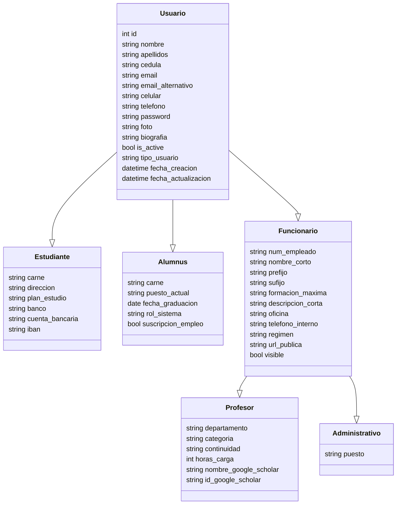
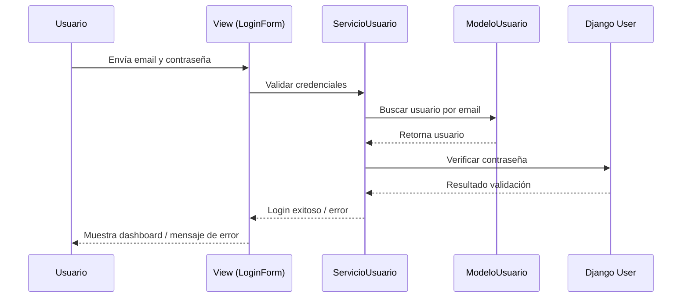
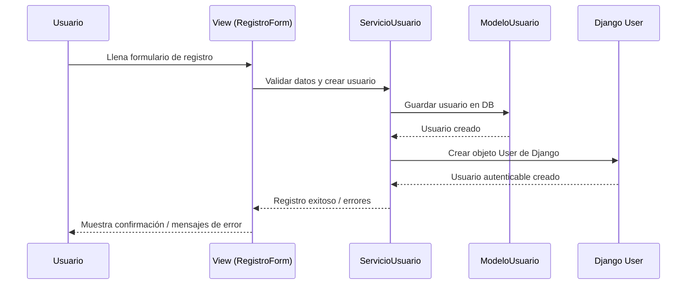
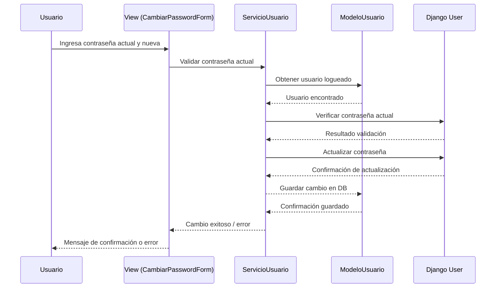

# Módulo Unificado de Login y Gestión de Usuarios - EIEInfo

## Introducción

Actualmente, EIEInfo cuenta con múltiples sistemas de login independientes para distintos tipos de usuarios: **estudiantes, alumni, profesores y administrativos**. Cada tipo de usuario mantiene su propio mecanismo de autenticación, manejo de sesiones y verificación de credenciales, lo que genera duplicación de código, inconsistencias y riesgos de seguridad.

El módulo propuesto busca **unificar la autenticación y la gestión de usuarios**, utilizando la infraestructura de Django (`django.contrib.auth`) como núcleo. Se centralizarán las operaciones de login, logout, manejo de contraseñas, permisos y sesiones, manteniendo perfiles específicos para cada tipo de usuario.

## Problemas actuales

### Repetición de código

- Cada módulo de usuario tiene vistas y formularios para login y validación de credenciales, duplicando lógica que podría centralizarse.
- Ejemplo: Alumni y Estudiantes guardan IDs de sesión manualmente y verifican contraseñas fuera de Django.

### Falta de validación y seguridad

- Autenticación basada en cookies o IDs de sesión propios, que pueden ser vulnerables a impersonación.
- Contraseñas duplicadas en distintos modelos (`Funcionario`, `Alumnus`) en lugar de usar un modelo centralizado seguro.
- Riesgo de manejo incorrecto de permisos y sesiones entre tipos de usuario.

### Falta de modularidad

- Lógica de login mezclada con otras funcionalidades dentro de modelos y vistas, violando el principio de responsabilidad única.
- Ejemplo: métodos de actualización de grupos de usuario o validación de formularios que realizan múltiples tareas al mismo tiempo.

### Carencia de documentación clara

- Módulos con código de login duplicado carecen de documentación consistente sobre cómo funciona la autenticación y gestión de sesiones.

## Objetivos y Alcance

### Objetivos

- Unificar el sistema de login para todos los tipos de usuarios.
- Centralizar la gestión de sesiones y permisos usando Django Auth.
- Crear perfiles específicos para cada tipo de usuario (Estudiante, Alumni, Funcionario → Profesor/Administrativo).
- Reducir la duplicación de código y aumentar la mantenibilidad.
- Asegurar que el sistema sea seguro, usando hashing de contraseñas y manejo estándar de sesiones.

### Alcance

- Reestructuración de todos los formularios y vistas de login.
- Migración de contraseñas y sesiones existentes a un sistema unificado.
- Creación de decoradores y funciones de contexto unificados para manejar sesiones y permisos.
- Implementación de mensajes de error consistentes y claros para el usuario.

## Justificación Técnica y Funcional

- **Técnica:** Se elimina la duplicación de código y se aprovechan las herramientas de Django, mejorando la seguridad y la modularidad del sistema.
- **Funcional:** Facilita la administración de usuarios, simplifica la extensión de funcionalidades futuras y garantiza que todos los usuarios utilicen el mismo mecanismo seguro para autenticarse y mantener sesión.

## Impacto Esperado

- Reducción de errores de autenticación y problemas de seguridad.
- Código más limpio y modular, más fácil de mantener y escalar.
- Experiencia de usuario consistente entre todos los perfiles.
- Posibilidad de implementar permisos y roles de manera uniforme usando grupos de Django.
- Base sólida para futuras mejoras en EIEInfo relacionadas con usuarios y accesos.

## Requisitos del Módulo: Login y Gestión de Usuarios

### Requisitos Funcionales

1. El sistema deberá permitir a cualquier usuario registrado iniciar sesión utilizando su correo electrónico y contraseña.
2. El sistema deberá permitir el registro de nuevos usuarios de tipo Alumni, Estudiante, Profesor o Administrativo.
3. El sistema deberá permitir a los usuarios recuperar su contraseña mediante correo electrónico.
4. El sistema deberá permitir a los usuarios cambiar su contraseña de manera segura desde su perfil.
5. El sistema deberá permitir asignar roles y permisos según el tipo de usuario (Alumni, Estudiante, Profesor, Administrativo).
6. El sistema deberá mantener la sesión activa según la configuración de tiempo establecida por el proyecto.
7. El sistema deberá registrar la última fecha y hora de inicio de sesión de cada usuario.
8. El sistema deberá permitir validar y verificar la autenticidad de cada usuario mediante Django Auth, evitando sesiones falsificadas.

### Requisitos No Funcionales

1. **Seguridad:** El sistema deberá proteger las contraseñas mediante hashing seguro y gestión de sesiones confiable.
2. **Rendimiento:** El sistema deberá permitir la autenticación de múltiples usuarios simultáneamente sin afectar la velocidad de respuesta.
3. **Usabilidad:** El sistema deberá proporcionar mensajes claros e informativos en caso de errores de login, registro o recuperación de contraseña.
4. **Escalabilidad:** El sistema deberá poder integrar futuros tipos de usuarios o servicios relacionados con autenticación sin modificar la arquitectura base.
5. **Mantenibilidad:** El sistema deberá utilizar una estructura modular con clases base y herencia para reducir la duplicación de código y facilitar futuras mejoras.

### Restricciones

1. El sistema deberá implementar el login y gestión de usuarios utilizando exclusivamente Django y sus librerías oficiales (`django.contrib.auth`, `django.contrib.sessions`, `django.contrib.messages`) para mantener consistencia y seguridad.
2. El sistema deberá mantener compatibilidad con la base de datos actual de EIEInfo (PostgreSQL o MySQL), sin crear nuevas tablas innecesarias ni modificar las existentes más allá de lo estrictamente necesario para la herencia de usuarios.
3. El sistema deberá seguir los estándares de codificación y estructura de EIEInfo, utilizando modelos, formularios y vistas de Django, evitando el desarrollo de soluciones personalizadas que ya estén cubiertas por el framework.

## Diagramas UML

### 1. Diagrama de Clases

Representa la estructura jerárquica de los usuarios del sistema, mostrando las **entidades**, sus **atributos** y las **relaciones de herencia**.

Explicación:
Este diagrama permite visualizar cómo los tipos de usuarios heredan de la clase base Usuario, y cómo Funcionario se especializa en Profesor y Administrativo. Todos los campos críticos para autenticación, contacto y perfil se centralizan en Usuario, evitando duplicación.

### 2. Diagramas de Secuencia – Módulo de Gestión de Usuarios y Sesiones

Este documento describe las interacciones entre las capas del sistema para las operaciones principales sobre los usuarios: **login**, **registro** y **cambio de contraseña**. Cada diagrama muestra cómo se comunican **usuario**, **vista**, **servicios**, **modelo** y **Django**.

---

#### a. Diagrama de Secuencia: Login de Usuario

Explicación:
El flujo describe cómo el sistema valida las credenciales de un usuario. La Vista recibe los datos, la capa de Servicio ejecuta la lógica de validación, el Modelo obtiene al usuario de la base de datos, y Django verifica la contraseña y gestiona la sesión.

#### b. Diagrama de Secuencia: Registro de Usuario

Explicación:
Este diagrama evidencia la creación centralizada de usuarios, con validaciones de datos y generación de un usuario autenticable en Django. Permite extender fácilmente el sistema para distintos tipos de usuarios sin duplicación de código.

### c. Diagrama de Secuencia: Cambio de Contraseña

Explicación:
Este flujo muestra cómo un usuario puede cambiar su contraseña de forma segura:

- La contraseña actual se verifica contra Django.
- La nueva contraseña se valida según políticas de seguridad.
- Tanto Django como el Modelo guardan el cambio, asegurando coherencia y trazabilidad.
