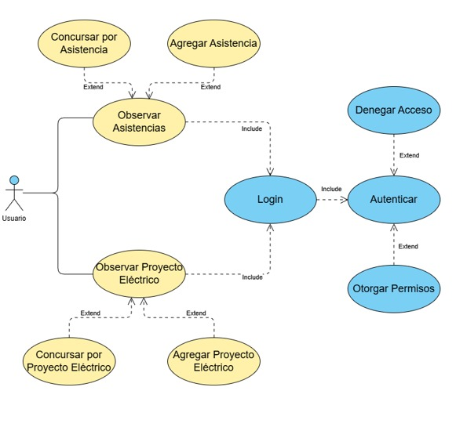
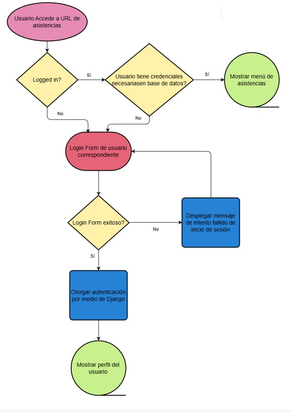
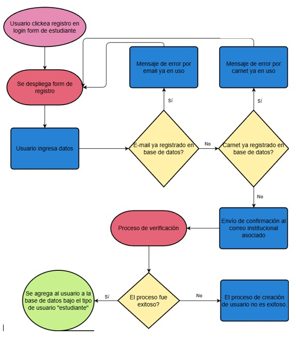
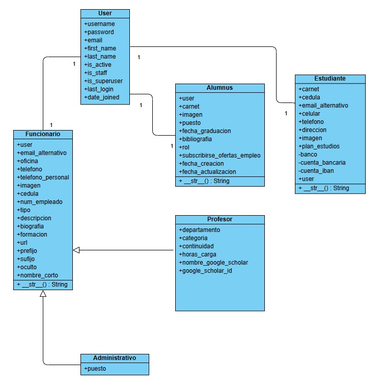
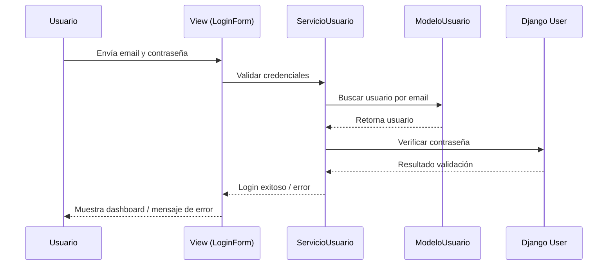
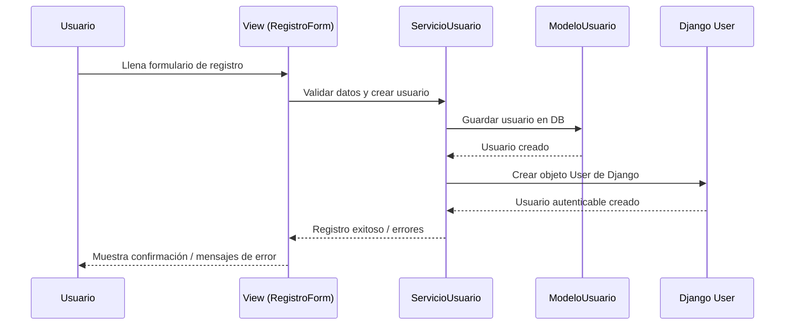
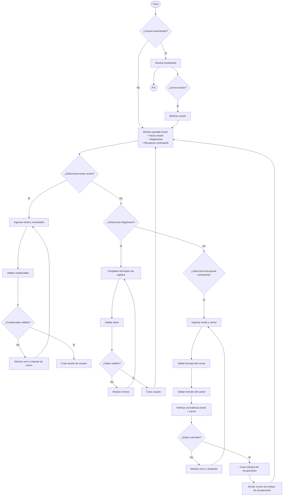
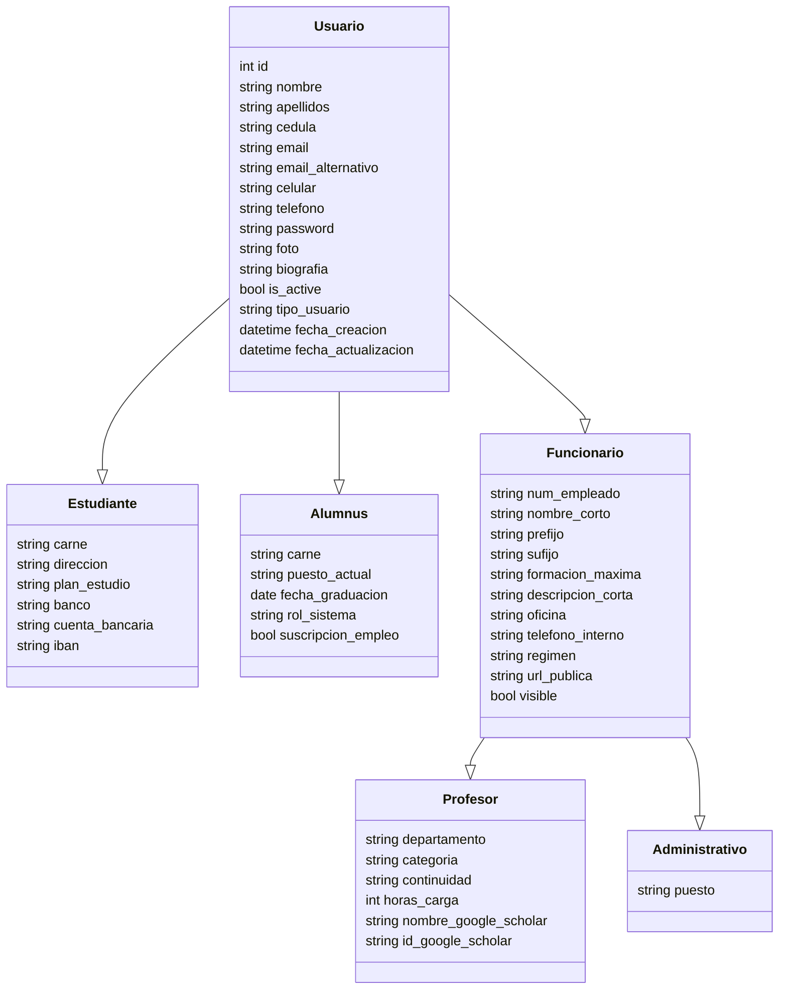

# Módulo Unificado de Login y Gestión de Usuarios - EIEInfo

## Introducción

Actualmente, EIEInfo cuenta con múltiples sistemas de login independientes para distintos tipos de usuarios: **estudiantes, alumni, profesores y administrativos**. Cada tipo de usuario mantiene su propio mecanismo de autenticación, manejo de sesiones y verificación de credenciales, lo que genera duplicación de código, inconsistencias y riesgos de seguridad.

El módulo propuesto busca **unificar la autenticación y la gestión de usuarios**, utilizando la infraestructura de Django (`django.contrib.auth`) como núcleo. Se centralizarán las operaciones de login, logout, manejo de contraseñas, permisos y sesiones, manteniendo perfiles específicos para cada tipo de usuario.

## Problemas actuales

### Repetición de código

- Cada módulo de usuario tiene vistas y formularios para login y validación de credenciales, duplicando lógica que podría centralizarse.
- Ejemplo: Alumni y Estudiantes guardan IDs de sesión manualmente y verifican contraseñas fuera de Django.

### Falta de validación y seguridad

- Autenticación basada en cookies o IDs de sesión propios, que pueden ser vulnerables a impersonación.
- Contraseñas duplicadas en distintos modelos (`Funcionario`, `Alumnus`) en lugar de usar un modelo centralizado seguro.
- Riesgo de manejo incorrecto de permisos y sesiones entre tipos de usuario.

### Falta de modularidad

- Lógica de login mezclada con otras funcionalidades dentro de modelos y vistas, violando el principio de responsabilidad única.
- Ejemplo: métodos de actualización de grupos de usuario o validación de formularios que realizan múltiples tareas al mismo tiempo.

### Carencia de documentación clara

- Módulos con código de login duplicado carecen de documentación consistente sobre cómo funciona la autenticación y gestión de sesiones.

## Objetivos y Alcance

### Objetivos

- Unificar el sistema de login para todos los tipos de usuarios.
- Centralizar la gestión de sesiones y permisos usando Django Auth.
- Crear perfiles específicos para cada tipo de usuario (Estudiante, Alumni, Funcionario → Profesor/Administrativo).
- Reducir la duplicación de código y aumentar la mantenibilidad.
- Asegurar que el sistema sea seguro, usando hashing de contraseñas y manejo estándar de sesiones.

### Alcance

- Reestructuración de todos los formularios y vistas de login.
- Migración de contraseñas y sesiones existentes a un sistema unificado.
- Creación de decoradores y funciones de contexto unificados para manejar sesiones y permisos.
- Implementación de mensajes de error consistentes y claros para el usuario.

## Justificación Técnica y Funcional

- **Técnica:** Se elimina la duplicación de código y se aprovechan las herramientas de Django, mejorando la seguridad y la modularidad del sistema.
- **Funcional:** Facilita la administración de usuarios, simplifica la extensión de funcionalidades futuras y garantiza que todos los usuarios utilicen el mismo mecanismo seguro para autenticarse y mantener sesión.

## Impacto Esperado

- Reducción de errores de autenticación y problemas de seguridad.
- Código más limpio y modular, más fácil de mantener y escalar.
- Experiencia de usuario consistente entre todos los perfiles.
- Posibilidad de implementar permisos y roles de manera uniforme usando grupos de Django.
- Base sólida para futuras mejoras en EIEInfo relacionadas con usuarios y accesos.

## Requisitos del Módulo: Login y Gestión de Usuarios

### Requisitos Funcionales

1. El sistema deberá permitir a cualquier usuario registrado iniciar sesión utilizando su correo electrónico y contraseña.
2. El sistema deberá permitir el registro de nuevos usuarios de tipo Alumni, Estudiante, Profesor o Administrativo.
3. El sistema deberá permitir a los usuarios recuperar su contraseña mediante correo electrónico.
4. El sistema deberá permitir a los usuarios cambiar su contraseña de manera segura desde su perfil.
5. El sistema deberá permitir asignar roles y permisos según el tipo de usuario (Alumni, Estudiante, Profesor, Administrativo).
6. El sistema deberá mantener la sesión activa según la configuración de tiempo establecida por el proyecto.
7. El sistema deberá registrar la última fecha y hora de inicio de sesión de cada usuario.
8. El sistema deberá permitir validar y verificar la autenticidad de cada usuario mediante Django Auth, evitando sesiones falsificadas.

### Requisitos No Funcionales

1. **Seguridad:** El sistema deberá proteger las contraseñas mediante hashing seguro y gestión de sesiones confiable.
2. **Rendimiento:** El sistema deberá permitir la autenticación de múltiples usuarios simultáneamente sin afectar la velocidad de respuesta.
3. **Usabilidad:** El sistema deberá proporcionar mensajes claros e informativos en caso de errores de login, registro o recuperación de contraseña.
4. **Escalabilidad:** El sistema deberá poder integrar futuros tipos de usuarios o servicios relacionados con autenticación sin modificar la arquitectura base.
5. **Mantenibilidad:** El sistema deberá utilizar una estructura modular con clases base y herencia para reducir la duplicación de código y facilitar futuras mejoras.

### Restricciones

1. El sistema deberá implementar el login y gestión de usuarios utilizando exclusivamente Django y sus librerías oficiales (`django.contrib.auth`, `django.contrib.sessions`, `django.contrib.messages`) para mantener consistencia y seguridad.
2. El sistema deberá mantener compatibilidad con la base de datos actual de EIEInfo (PostgreSQL o MySQL), sin crear nuevas tablas innecesarias ni modificar las existentes más allá de lo estrictamente necesario para la herencia de usuarios.
3. El sistema deberá seguir los estándares de codificación y estructura de EIEInfo, utilizando modelos, formularios y vistas de Django, evitando el desarrollo de soluciones personalizadas que ya estén cubiertas por el framework.

## Diagramas UML

### 1. Diagrama de caso de uso del módulo

### 2.1. Diagrama de flujo de primer caso de uso

### 2.2 Diagrama de flujo de segundo caso de uso

### 3. Diagrama de clases del sistema de usuario

### 4. Diagramas de Secuencia – Módulo de Gestión de Usuarios y Sesiones

Este documento describe las interacciones entre las capas del sistema para las operaciones principales sobre los usuarios: **login**, **registro** y **cambio de contraseña**. Cada diagrama muestra cómo se comunican **usuario**, **vista**, **servicios**, **modelo** y **Django**.

---

#### a. Diagrama de Secuencia: Login de Usuario

Explicación:
El flujo describe cómo el sistema valida las credenciales de un usuario. La Vista recibe los datos, la capa de Servicio ejecuta la lógica de validación, el Modelo obtiene al usuario de la base de datos, y Django verifica la contraseña y gestiona la sesión.

#### b. Diagrama de Secuencia: Registro de Usuario

Explicación:
Este diagrama evidencia la creación centralizada de usuarios, con validaciones de datos y generación de un usuario autenticable en Django. Permite extender fácilmente el sistema para distintos tipos de usuarios sin duplicación de código.

### 5. Diagrama de actividad

Este diagrama presenta el flujo completo del módulo de usuarios, incluyendo autenticación, registro y recuperación de contraseña.

### 6. Diagrama de base de datos

Representa la estructura jerárquica de los usuarios del sistema, mostrando las **entidades**, sus **atributos** y las **relaciones de herencia**.

Explicación:
Este diagrama muestra cómo todas las personas que interactúan con el sistema ahora derivan de la clase base Usuario, unificando el manejo de datos.
Anteriormente, únicamente los funcionarios heredaban de una clase común; sin embargo, con el nuevo diseño todos los tipos de usuarios comparten la misma estructura fundamental (credenciales, contacto, información de perfil).

A partir de Usuario se especializan clases más específicas —como Funcionario, que a su vez se divide en Profesor y Administrativo— sin duplicar atributos esenciales. Esto permite una jerarquía más coherente, facilita la autenticación y reduce la repetición de información.

## Arquitectura Propuesta
Se propone una arquitectura por capas. Se busca que los módulos ya creados de Funcionario, Estudiante, Profesor, Alumnus y Administrativo sigan una lógica de capas correcta, en donde sus campos están relacionados a los datos del modelo y no a realizar funciones extra, además de agregar la referencia al User de Django, que proporciona funciones de autenticación y manejo de usuarios (inclusive grupos), como un intento de fomentar que la nueva creación de usuarios a través de este usuario y no por medio de creaciones de usuarios independientes a lo largo del proyecto.

Las funciones extra que estaban localizadas en estos módulos se mueven a una capa de servicios a las cuales todos los usuarios pueden acceder (ya que todos los módulos definen estas mismas funciones dentro de models.py)

Los componentes que se van a encargar de los procesos mencionados anteriormente son:
- Search Service: Proporciona búsquedas en base a la expresión brindada. Para cada usuario este método es ligeramente diferente por lo que se va a desarrollar bajo el patrón Strategy, de esta forma si en el futuro se quiere utilizar una expresión diferente para buscar se puede simplemente agregar la estrategia deseada.

- EnviarEmail: Este método es utilizado por todos los usuarios exactamente de la misma manera, por lo que se moverá a una capa de servicios en donde se dejará como una función que puede ser utilizada por cualquier proceso.

- SetPassword: Nuevamente, es un servicio que utilizan todos los usuarios por lo que la lógica se coloca en la capa de servicios como una función disponible para todo tipo de usuario. Sin embargo, la forma en la que se brinda y guarda la contraseña es por medio del User de Django y no la forma personalizada que utilizaba el código anterior.

- SetImageDefault: De nuevo, este código está presente en algunos de los usuarios en una capa en la cual no debería de estar (models.py), por lo que se moverá a la sección de servicios como una función.

Otro componente importante son los decoradores de autenticación del sistema. Actualmente estos dependen del "id" dentro de la sesión del usuario en el navegador, el cual es manejado por la cookie "session id". Si esta cookie es tomada, un tercero puede aparentar ser un usuario importante y generar daños en la página, por lo que utilizar el sistema de autenticación de usuarios de Django es de relevancia.

Actualmente, existe una gran cantidad de decoradores que se encargan de garantizar permisos a los usuarios, los cuales serán modificados para utilizar funciones de Django como método de autenticación.

Hay más funciones en models.py que deberían de moverse a la capa de servicios como los métodos encargados de recuperar contraseña, sin embargo, por tiempo no se modificarán pero es de utilidad conocerlo.

### Validaciones a implementar

Las validaciones a implementar para este proyecto tienen relación a la creación del nuevo usuario y su integración correcta con el resto del sistema. Se debe de validar que luego de la primer migración, todo elemento presente en la base datos asocidado a un funcionario, estudiante o alumnus, tenga un Usuario asignado en la tabla de usuario de Django.

Además, se debe de validar que la migración de datos presentes haya sido exitosa. Esto quiere decir que los campos de email, nombre, apellidos y contraseña apunten correctamente a los campos del nuevo usuario y que además, se hayan eliminado exitosamente de la tabla anterior que aparentaba funcionar como usuario en el sistema. Cabe destacar que las dos tablas deben de coexistir exitosamente.

Por otro lado, se debe de validar que luego de los cambios realizados a los modelos se hayan realizado todas las confirmaciones de dependencias presentes a lo largo de todo el código. Es decir, se debe de validar que todos los sistemas que dependían de servicios en los modelos de usuario funcionen correctamente al integrarse con la nueva capa de servicios.

También, se debe de confirmar que los cambios a los decoradores no generan conflictos en funcionalidad del sistema y que además, los usuarios permanecen con los permisos de acuerdos a sus usuarios/roles intactos.

### Posibles riesgos y mitigación

En primer lugar, se corre el riesgo de que alguna migración en la base de datos no se realice correctamente. Debido a esto, la posible mitigación de esto es realizar una migración progresiva del sistema, verificando que el sistema no deja de funcionar al realizar diversos cambios y si lo hace, tener una forma de volver a una versión anterior. La acción que se tomará para mitigar definitivamente es realizar cambios pequeños enfocados en un único módulo mientras se garantiza por medio de pruebas que el sistema funciona. Una vez que un módulo completo funciona, se procederá a realizar la implementación del siguiente hasta tener todo el sistema listo.

Además, otro riesgo presente es la falta de dependencias satisfechas al momento de separar los métodos presentes en los módulos de models.py a la capa de servicios. Para esto, de nuevo, se debe realizar cambios progresivos con respecto a los módulos y probar la funcionalidad constantemente para garantizar que el sistema funciona correctamente. 

Por otro lado, con respecto a los decoradores, ya que tantos de estos dependen del campo id presente en la sesión del navegador, puede ocurrir que un método que requiera de ese id no fuera actualizado, lo que ocasionaría una falla en el sistema. Ante esto, se debe de programar de tal forma que se utilice el nuevo sistema como base, pero que se utilice el otro sistema en caso de alguna falla; lo anterior se utiliza como medida de mitigación para mantener el sistema estable volviendo a su forma de ejecutarse anteriormente. Se deben de agregar chequeos de sistema para conocer cuál sistema se está utilizando (viejo o nuevo) y poder diagnosticar los motivos del por qué. Además, en la medida de lo posible se planea utilizar el método Adapter para mantener consistencia con el formato de los datos esperados por el sistema antiguo.

## Plan de Implementación

Como plan de implementación:

- Se debe de agregar el usuario de Django por medio de OneToOneField(User) a los modelos Estudiante, Alumnus y Funcionario para enlazar las tablas a auth_user.
- Se debe realizar una migración de esta acción en la base de datos.
- Generar un código que se encargue de asociar el email y las contraseñas, así como estado de activo o inactivo, nombre y apellidos en los campos del nuevo usuario para estudiantes.
- Corroborar que los datos de estudiantes fueron traspasados exitosamente.
- Implementar el nuevo sistema de autenticación y lógica de inicio de sesión para estudiantes. Se debe de utilizar el nuevo sistema como forma base o la forma antigua si esta falla.
- Realizar pruebas individuales para determinar cómo funciona el sistema ante los cambios y corregir en base a los resultados.
- Una vez que las pruebas son superadas, repetir los pasos para el módulo de funcionarios, administradores, profesores y Alumni. Se repiten los pasos una vez que se termina con un único módulo.
- Una vez que el sistema de autenticación funciona correctamente, se crea la capa de servicios generales que utilizarán los usuarios.
- Se realizan los cambios necesarios en los otros segmentos del código que dependían de estos servicios por módulo. Se debe intentar utilizar la versión nueva y en caso de fallo utilizar la versión antigua para evitar errores en tiempo de ejecución.
- Se realizan pruebas al nuevo módulo de servicios para asegurarse que fue integrado correctamente a lo largo de todo el código de la página.
- Una vez que las pruebas son superadas, se eliminan de los módulos de usuarios estos servicios generales y se eliminan además los campos de contraseña, nombre, apellidos y activo, ya que estos ya no son parte de los módulos de usuario antiguos de la página. 

