# Semana 4

## Pruebas Formales

### Matriz de pruebas con casos, pasos, resultados esperados vs obtenidos

- El sistema debe de solicitar al administratidor que rellene los campos obligatorios de los modelos correspondientes para los diferentes tipos de usuario.

- El sistema debe de solicitar el enlace a un usuario existente o la creación de un nuevo usuario cuando se quiera crear un usuario de cualquier tipo.

- El sistema debe de crear exitósamente al usuario y enlazarse correctamente al tipo de usuario correspondiente cuando es creado desde el panel del administrador.

- El sistema debe garantizar acceso a la página base de funcionarios, administrativos, estudiantes y alumni para usuarios válidos de este tipo.

- El sistema debe de mostrar la página correspondiente para usuarios con permisos extra como ser parte de una comisión o presentar una jefatura.

- El usuario puede realizar acciones dentro de esa página con normalidad

- El sistema debe de rechazar el acceso a páginas protegidas a usuarios que no presenten los permisos necesarios para accederlas.

- El sistema debe de cerrar la sesión de usuarios conectados si se cambia la contraseña de la cuenta.

Como parte de resultados esperados se tiene que todo el sistema funcione con normalidad. Los cambios realizados en el backend no deberían de afectar de ninguna forma en cómo se observa la página actualmente ni en como el usuario interactúa con la página. Con respecto al administrador, se espera que la creación de usuarios sea un proceso más directo y sencillo.

En los resultados esperados se observa el comportamiento esperado en la mayoría de las funcionalidades. El sistema aparenta funcionar de la misma forma para el usuario y los usuarios tienen acceso a sus funciones. Sin embargo, en la sección de registro, como el campo del form difiere del indicado al html desaparece el campo de contraseña, lo que es esperado y se arreglará si se desarrolla más a fondo el sistema de usuario unificado para registro. Con respecto al administrador, se considera que la creación de usuarios efectivamente es más directa y sencilla.

### Capturas o evidencia de ejecución

En la siguiente imagen se puede observar que el sistema solicita al administrador rellenar los campos obligatorios antes de poder realizar la creación de un usuario nuevo, para todos los tipos de usuario. 

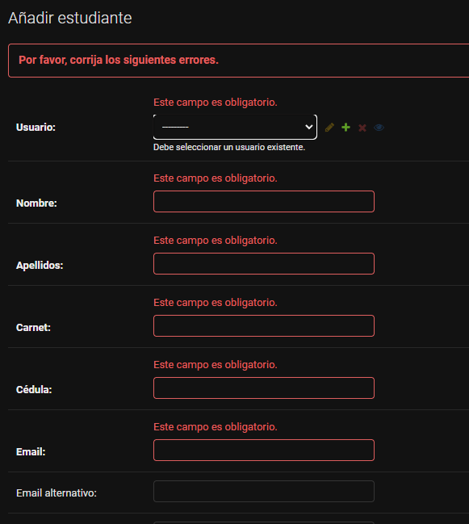

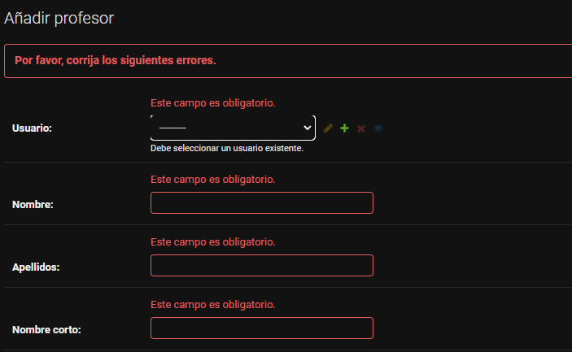

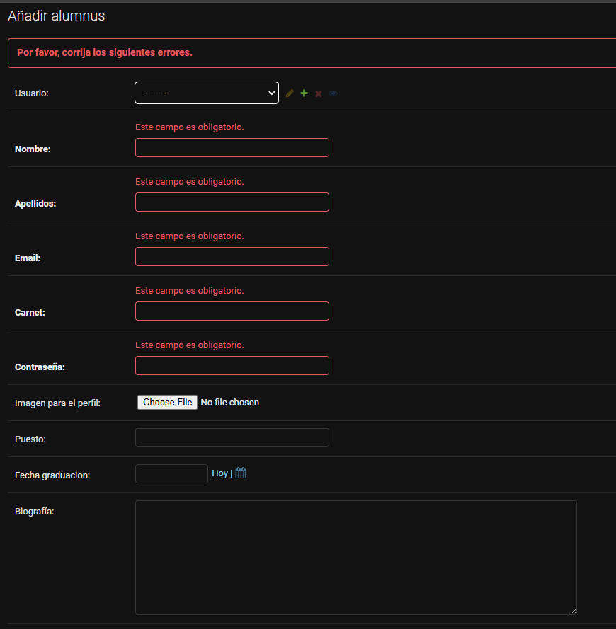

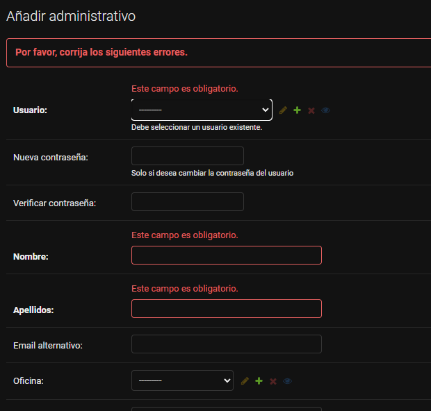

Por otro lado, en la siguiente imagen se puede observar como el sistema solicita la creación de un usuario de Django al momento de crear otro tipo de usuario.

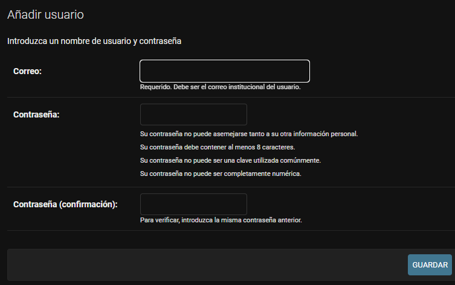

Por otro lado, el usuario correspondiente se crea exitosamente desde el panel de administrador como se puede observar en la siguiente imagen:

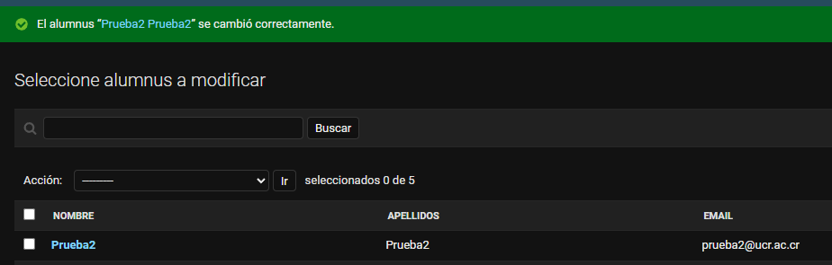

Además, se puede observar el acceso exitoso a cada tipo de usuario a su portal correspondiente en las siguientes imagenes:

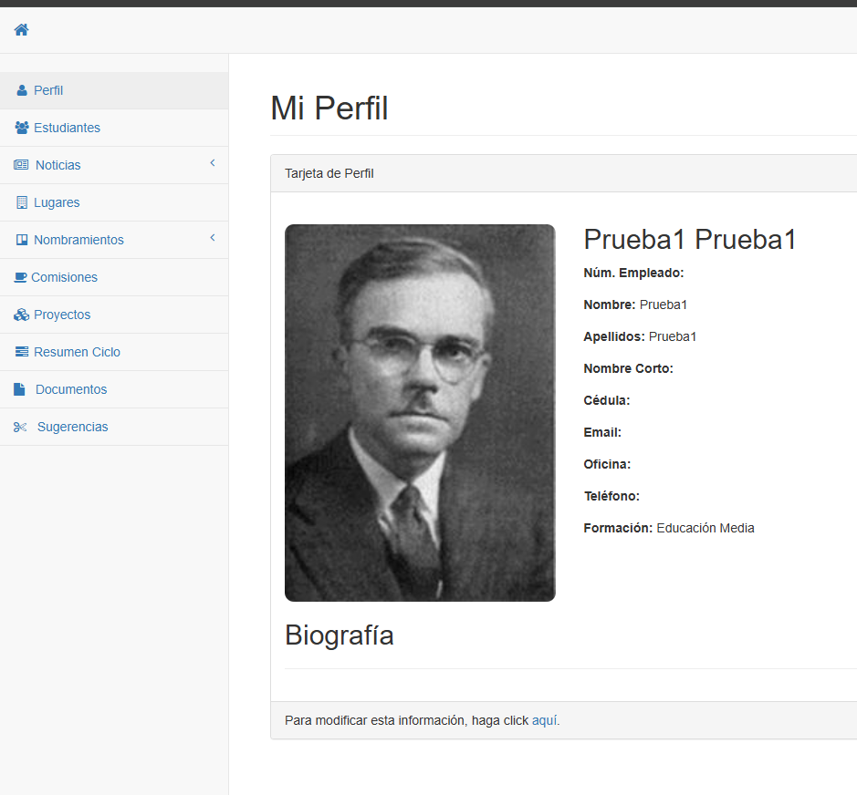

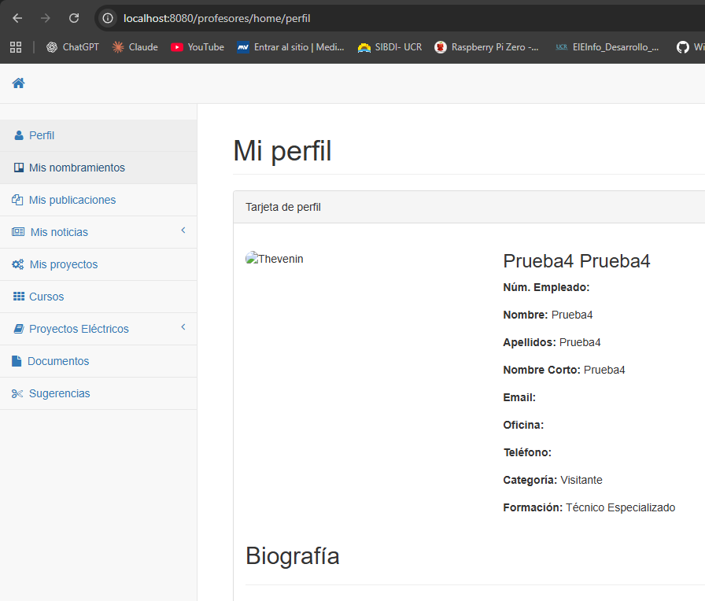

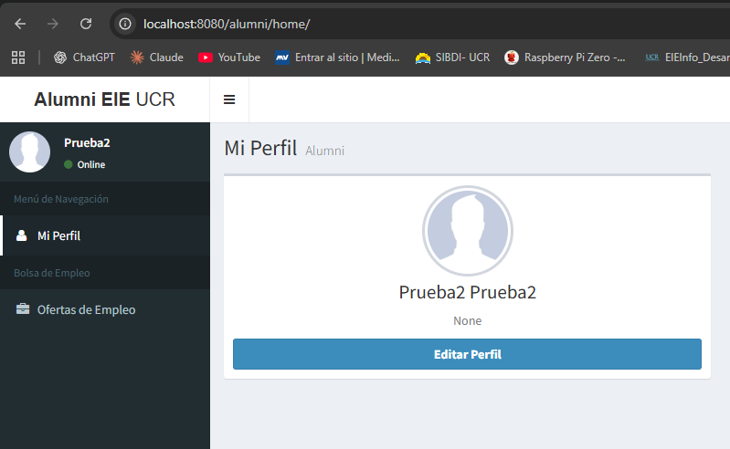

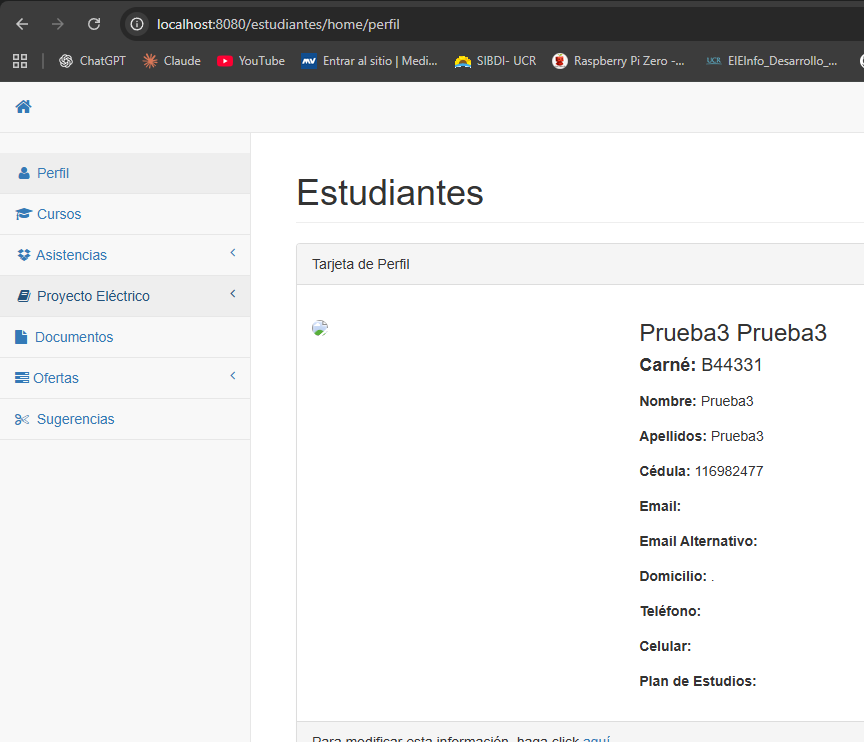

Por otro lado, en la siguiente imagen se puede observar el portal de un profesor con permisos extra como ser parte de una comisión, en donde se puede apreciar comom este usuario presenta una funcionalidad extra para generar asistencias ya que es parte de una comisión. 

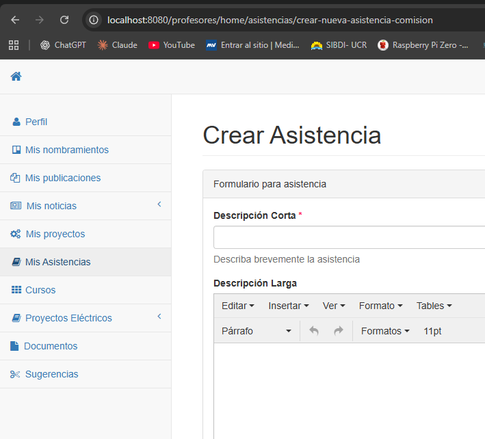

En su contraparte, en la siguiente imagen se puede observar lo que ocurre cuando un usuario intenta acceder a una página en la cual no presenta permisos.

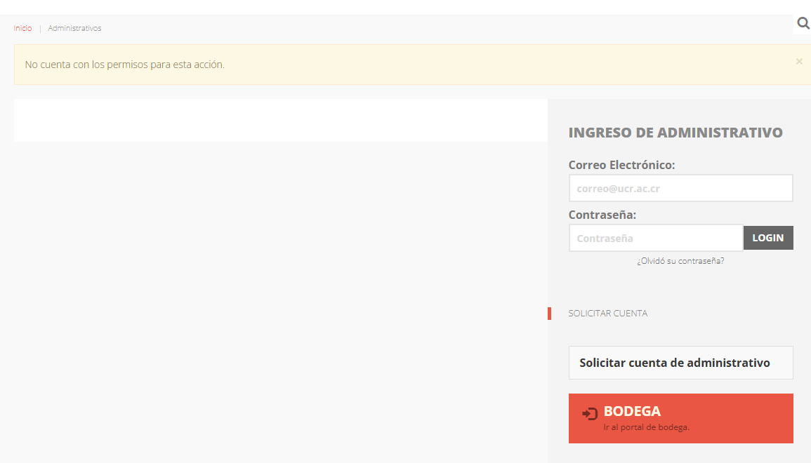

### Corrección final de errores

Como correción final de errores, el sistema base de Alumnus no permitía que el campo de email fuera "blank". Cuando se creaba un usuario nuevo utilizando los campos del modelo User de Django, este campo se dejaba en blanco y generaba colisiones en la base de datos.

Ante esto, la solución puede ser realizar una migración para borrar estos campos de los modelos originales, sin embargo, por compatibilidad temporal con el sistema antiguo se mantienen. Ante esto, se optó por rellenar estos campos automáticamente (el modelo antiguo) con los campos del nuevo para garantizar la funcionalidad del sistema. Esto es una solución temporal y la mejor opción es optar por modificar el modelo con respecto al nuevo sistema.

## Evaluación crítica del impacto

### ¿Qué problema resolvió?

El sistema actual de EIEInfo ahora cuenta con una base para realizar un sistema de usuarios unificado. Anteriormente, los modelos de usuario existían independientemente y no podían utilizar los métodos de manejo de usuarios y autenticación de Django. Además, la creación de usuarios del lado de administración era sumamente complejo y poco claro.

En el proyecto se implementó una creación de usuarios más sencilla para los administradores, lo que se traduce en pruebas más sencillas en desarrollo de módulos futuros o modificación a módulos existentes que requieran de interacción con usuarios.

Además, se utilizó este nuevo sistema de usuarios para realizar un sistema que utiliza métodos de Django para verificar la autenticidad del usuario. Esto es de vital importancia ya que el sistema antiguo, una vez que otorgaba permisos a un usuario, este la asignaba un identificador en la sesión que era utilizado para validar acciones de usuario. 

Lo anterir genera una vulnerabilidad a nivel de manejo remoto de la cuenta, ya que el dueño de la cuenta no tiene forma de eliminar una sesión activa de manera remota. Si una persona accede a su cuenta de manera remota, se le asignaba el identificador en la sesión y su sesión era válida de manera persistente. Los métodos de autenticación de Django realizan chequeos de la cuenta en cada request del usuario por medio de la contraseña, por lo que si esta cambia en algún momento, toda sesión activa es invalidada.

En base a lo anterior se resolvió una leve vulnerabilidad en el sistema de autenticación, además de problemas en la experiencia del desarrollador o administrador con respecto a la creación y manejo de usuarios.

### ¿Qué mejoras introdujo respecto al estado inicial de Semana 1?

Como se mencionó anteriormente, el sistema de EIEInfo presenta un inicio en el desarrollo de sistema unificado de usuarios. Esto genera una estructura más clara para el proyecto con lo respecta a los usuarios del sistema, lo que permite desarrollar futuros con mayor facilidad ya que los desarrolladores no tienen que invertir gran cantidad de tiempo en comprender cómo difiere cada sistema de usuarios.

Por otro lado, se implementó un sistema de autenticación utilizando los métodos dados por Django, lo que genera que el sistema actual sea más robusto con respecto a la seguridad de la cuenta. 

Para realizar las medidas dadas anteriormente, se generó un módulo nuevo en donde se concentra la lógica de los permisos y además se desarrollaron clases que brindan funcionalidades generales a los usuarios en el sistema de login (los usuarios esencialmente pasan por el mismo proceso de login, por lo que tener una capa que brinde abstraiga logica y los usuarios puedan utilizarla haciendo una herencia de esta clase es más escalable que re definir el proceso para cada tipo de usuario). Lo anterior permite el inicio del desarrollo de la capa de usuarios general, en donde todo tipo de usuarios puede utilizar métodos presentes en ella para desarrollar funcionalidades más complejas.

Además, la lógica de permisos se encarga de generar los decoradores que utiliza el sistema para garantizar funcionalidades  a los usuarios de una manera mantenible y escalable. Se utilizó el patrón de diseño Strategy Pattern para generar objetos que describen reglas del sistema (ser jefatura, ser parte de una comisión, etc) para generar reglas a partir de las condicionales de estos objetos (ejemplo: tiene permiso si es jefatura y es parte de comision). Lo anterior introduce una mejora en la escalabiliad del sistema de permisos ya que anteriormente cada decorador correspondía a una gran cantidad de lógica para otorgar un permiso. Ahora, si se logra describir la lógica en un objeto sencillo se puede generar cualquier combinación de condiciones sin necesidad de ree escribir estas condiciones una y otra vez como se realizaba en el estado inicial de la semana 1.

### Indicador cualitativo y/o cuantitativo de impacto

Con respecto al indicador cualitativo, en base a los datos brindados por otras personas que desarrollron sobre la página en su estado inicial en semana 1, crear un usuario o trabajar con ellos representó un problema recurrente. O la creación por medio de administrador no funcionaba del todo o se generaban problemas en la base de datos por la interacción del modelo de usuario. Ante esto, se espera que los cambios realizados aumenten la *sencillez* con la que se desarrollan módulos en EIEInfo. Con el sistema implementado, crear y modificar usuarios es sencillo, descriptivo y no requiere conocer el sistema a fondo.

Por otro lado, como el desarrollo del nuevo sistema de autenticación se desarrolló de forma escalable, se espera una mejoría en la *calidad* del código y en el desarrollo de nuevo código que requiera de otorgar permisos a los usuarios, esto debido a que el nuevo sistema es más mantenible y cambiar la lógica de autenticación/permisos requiere cambiar módulos pequeños y no grandes bloques de código.

Finalmente, se espera que a largo plazo mantener la *conformidad* y *confianza* del usuario con los sistemas de seguridad empleados en la página web. Como usuario, el no poder manejar su cuenta de manera remota se siente como una vulnerabilidad considerable, ya que si un tercero logra obtener acceso a la sesión del usuario este tendrá acceso de manera persistente mientras no realice logout. Ante esto, se espera que la medida de la mejora en la seguridad del sistema evite este problema con los usuarios en un futuro y por ende, mantener limpia la reputación de la página web.

### Qué tan mantenible y escalable es la solución

La solución propuesta es ampliamente mantenible ya que se enfocó en no cambiar drásticamente el sistema inicial. La forma en la que se accede a los usuarios es ligeramente distinta, pero todos los métodos creados anteriormente para las tablas existenes siguen funcionando en su mayoría, ya que las tablas de usuario anteriores siguen existiendo, simplemente se realizó una extensión del modelo User de Django como un elemento nuevo en las tablas de usuario anteriores. 

Por otro lado, se desarrollaron los módulos con la escalabilidad en mente y más bien, la lógica que se repetía una y otra vez en el sistema de login para cada usuario ahora forma parte de una capa de servicios de usuario, en la cual todos los usuarios pueden adquirir esta funcionalidad común y modificar las validaciones como corresponda (se utilizó el método de Template). Con respecto a los permisos se realizó lo mismo, la solución propuesta busca centralizar la creación de permisos y busca utulizar métodos escalables y mantenibles como el Strategy Pattern. Antes, cada decorador presentaba su propia lógica para otorgar permisos, ahora, la lógica se extrae como objetos sencillos que posteriormente se utilizan en una combinación de condicionese "Y" y "O" para generar el decorador, lo que permite generar una mayor cantidad de decoradores en cualqueir combinación sin necesidad de reescribir una y otra vez la lógica de las reglas necesarias.

Debido a lo anterior, se afirma que la solución es altamente mantenible y escalable.

## Propuesta de evolución

### **Mejora 1: Unificación completa del sistema de usuarios**

**Estado actual:**  
El sistema cuenta con un login unificado y reforzado en seguridad, permitiendo un control más consistente de sesiones y permisos.

**Pendiente:**  
Implementar el registro unificado directamente en la plataforma para que usuarios (estudiantes, profesores, administrativos y alumni) puedan crearse sin depender del panel de administración.

**Beneficio:**  

- Permite que cualquier módulo nuevo se conecte fácilmente al sistema de usuarios.  
- Reduce inconsistencias y errores como los observados en proyectos anteriores.

---

### **Mejora 2: Añadir más elementos a la capa de servicios de usuario**

Actualmente los modelos de usuarios utilizan muchos métodos que no pertenecen a esta capa. Además, muchos de estos métodos se declaran para todos los tipos de usuario

**Pendiente:**  
Reubicar los métodos que no corresponden al modelo dentro de la capa de servicios de usuario, reorganizando la lógica para que cada responsabilidad esté correctamente aislada y que cualquier usuario que lo necesite pueda acceder a él.

**Beneficio:**  

- Estructura más limpia y modular. Modelos mantienen lógica esencial.
- Elimina la duplicación de código, facilita pruebas unitarias y fortalece mantenibilidad.

---

### **Mejora 3: Implementación de pruebas automáticas y CI/CD**

Actualmente no existe un flujo automatizado de verificación ni despliegue.

**Pendiente:**  

- Crear un conjunto de pruebas automáticas (unitarias y funcionales).  
- Incorporar un pipeline de CI/CD para integrar, validar y desplegar cambios de forma segura.

**Beneficio:**  

- Reduce errores al añadir nuevas funcionalidades.  
- Aumenta la calidad del código y agiliza el desarrollo.

---

## 2. Hoja de Ruta Propuesta

### **Fase 1 — Implementación del registro unificado (Semana 3–4)**

- Crear vistas y formularios de registro para cada tipo de usuario.  
- Ajustar validaciones, permisos y carga inicial de roles.  
- Probar el flujo completo de creación de cuentas.

### **Fase 2 — Expansión y depuración de la capa de servicios de usuario (Semana 4–5)**

- Identificar los métodos que actualmente residen en los modelos y que deben ser trasladados a la capa de servicios.  
- Crear servicios específicos para operaciones de negocio recurrentes (creación, actualización, validaciones, activación y gestión de estados).  
- Centralizar la lógica compartida para que pueda ser utilizada por cualquier tipo de usuario sin necesidad de duplicarla.  
- Actualizar vistas y formularios para que interactúen exclusivamente con la capa de servicios.  
- Verificar que los modelos permanezcan mínimos, limitados a su estructura y relaciones, sin contener lógica de negocio.

### **Fase 3 — Pruebas automáticas (Semana 5–6)**

- Crear pruebas unitarias para login, permisos y creación de usuarios.  
- Añadir pruebas funcionales para roles específicos.  
- Integrar un umbral de cobertura mínima (60–70%).

### **Fase 4 — CI/CD (Semana 6–7)**

- Configurar pipeline en GitHub Actions o GitLab CI.  
- Automatizar instalación → pruebas → build → despliegue.  
- Validar que no se puedan fusionar cambios que no pasen las pruebas.

### **Fase 5 — Documentación final (Semana 8)**

- Documentación completa del sistema de usuarios.  
- Agregar guía de contribución y buenas prácticas.

---

## 3. Aspectos No Logrados pero Valiosos

### **Gestión mejorada de súper usuarios**

No se completaron cambios como:

- Ajustes al menú del súper usuario.  
- Uso obligatorio de correos institucionales (`@ucr.ac.cr`) como usernames.

**Valor agregado:**  
Mejoraría la navegación y estandarización de usuarios con permisos elevados.

---

### **Documentación profunda y estándares**

Se generó documentación parcial, pero falta completar:

**Pendiente:**  

- Documentar flujos avanzados de sesión, seguridad y permisos.  
- Unificar estándares de estilo, arquitectura y buenas prácticas.

---

## **Conclusión**

Las mejoras propuestas fortalecen la cohesión del sistema, aumentan la calidad del código y permiten que el proyecto escale de manera ordenada. La hoja de ruta presentada facilita la implementación progresiva y reduce riesgos en el desarrollo futuro.
