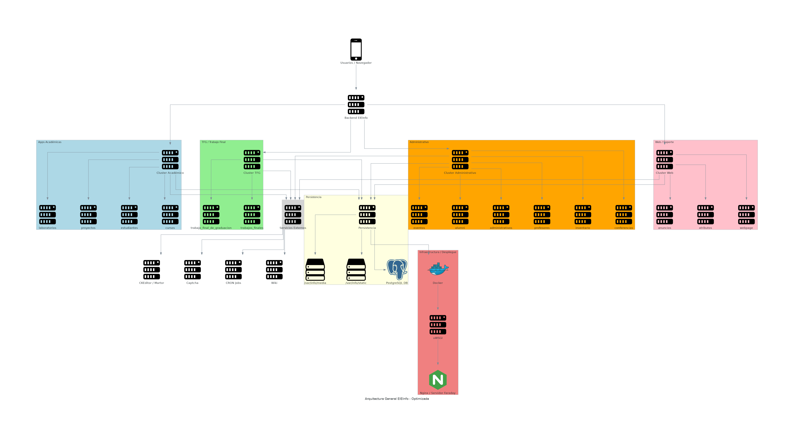
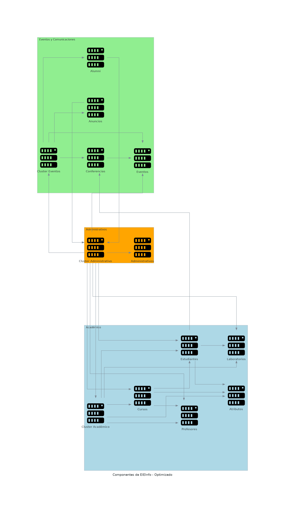
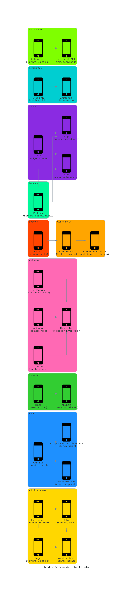

# 1. Arquitectura General del Sistema

El **diagrama de arquitectura** muestra cómo se organiza y comunica todo el ecosistema de EIEInfo, desde el **frontend** hasta la **infraestructura de despliegue**.  
Proporciona una vista global del sistema y sus interacciones principales.

### Descripción general

La arquitectura se compone de **seis niveles principales**:

1. **Frontend**  
   - Interfaz utilizada por los usuarios (navegadores y dispositivos móviles).  
   - Se comunica con el backend mediante HTTP/HTTPS.

2. **Backend principal**  
   - Núcleo del sistema encargado de procesar solicitudes y coordinar módulos internos.  
   - Basado en frameworks web (por ejemplo, Django / uWSGI).

3. **Módulos funcionales**  
   - Agrupados por dominios:
     - *Académico:* estudiantes, cursos, laboratorios, proyectos.  
     - *TFG:* trabajos finales de graduación.  
     - *Administrativo:* personal, inventario, conferencias, eventos, alumni.  
     - *Web / Soporte:* anuncios, atributos, página institucional.  

4. **Servicios externos**  
   - Extienden la funcionalidad del sistema: CRON jobs, Wiki, CKEditor/Martor y Captcha.

5. **Persistencia**  
   - Almacenamiento permanente en **PostgreSQL**, y manejo de archivos estáticos/media en `/var/info`.

6. **Infraestructura y despliegue**  
   - Basada en **Docker**, **uWSGI** y **Nginx (Servidor Faraday)** para ejecución y publicación.

### Flujo general

Usuarios → Nginx → uWSGI → Backend → Módulos → Servicios / Base de datos / Almacenamiento

### Diagrama

---

## 2. Relación entre Componentes

El **diagrama de componentes** detalla cómo los **módulos y clusters** se relacionan entre sí dentro del ecosistema EIEInfo.  
Muestra dependencias funcionales y flujos de interacción a nivel de sistema, sin entrar aún en el modelo de datos.

### Estructura general

- **Cluster Administrativo:** nodo central que coordina la comunicación entre los módulos académicos y de eventos.  
- **Cluster Académico:** agrupa entidades como Cursos, Estudiantes, Profesores, Atributos y Laboratorios.  
- **Cluster de Eventos y Comunicaciones:** abarca Eventos, Conferencias, Anuncios y Alumni.

### Conexiones principales

- El **administrativo** gestiona y conecta con los módulos académicos y de eventos.  
- **Cursos, Estudiantes y Profesores** comparten dependencias con Atributos y Laboratorios.  
- **Anuncios y Alumni** se vinculan con la capa administrativa para comunicación y gestión institucional.

### Diagrama

---

## 3. Modelo General de Datos

El **modelo de datos** describe las principales entidades y sus relaciones dentro del sistema EIEInfo.  
Representa una **visión lógica y conceptual** de la base de datos, organizada por dominios o módulos.

### Estructura por dominios

| Dominio | Entidades principales | Ejemplo de relaciones |
|----------|----------------------|------------------------|
| **Administrativos** | `Funcionario`, `Nombramiento`, `Jefatura`, `Lugar` | Un funcionario puede tener varios nombramientos y pertenecer a una jefatura. |
| **Alumni** | `Alumnus`, `OfertaEmpleo`, `RecuperarPasswordAlumnus` | Los exalumnos pueden publicar ofertas y recuperar su acceso. |
| **Anuncios** | `Frase`, `Anuncio` | Las frases se vinculan con anuncios activos. |
| **Atributos** | `NivelRubrica`, `Indicador`, `Criterio`, `Descriptor` | Los descriptores se construyen combinando niveles, criterios e indicadores. |
| **Conferencias** | `Conferencia`, `CuotasConferencia` | Cada conferencia tiene cuotas asociadas a estudiantes. |
| **Cursos** | `Curso`, `Catedra`, `Grupo` | Los cursos se imparten por grupos asociados a profesores y estudiantes. |
| **Estudiantes** | `Estudiante`, `Asistencia` | Cada estudiante registra su asistencia a distintas actividades. |
| **Eventos** | `Evento` | Pueden estar asociados a conferencias o actividades especiales. |
| **Laboratorios** | `Laboratorio`, `LaboratorioCiclo` | Los laboratorios se organizan por ciclo académico. |
| **Profesores** | `Profesor` | Relacionado con cátedras y grupos. |

### Diagrama

---

## Notas finales

- Los tres diagramas fueron generados con la librería [**Diagrams (by Mingrammer)**](https://diagrams.mingrammer.com/), utilizando Python para definir relaciones y colores personalizados.  
- Los **colores representan dominios funcionales**, y las **flechas indican flujos de comunicación o dependencia**.  
- En conjunto, estos diagramas ofrecen una **visión completa** del sistema:  
  - **Arquitectura general** (estructura y flujo global).  
  - **Componentes** (interacción entre módulos).  
  - **Modelo de datos** (estructura lógica de la información).

---
