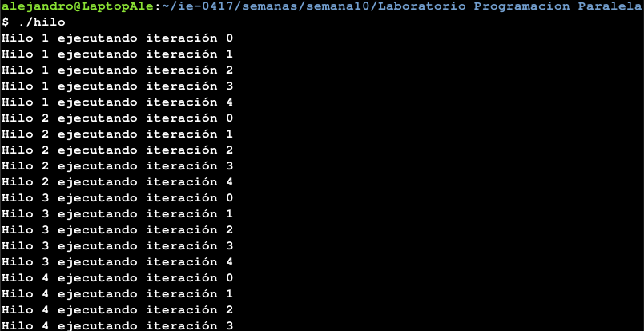
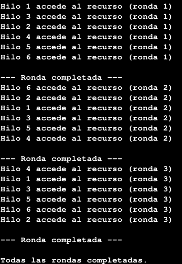
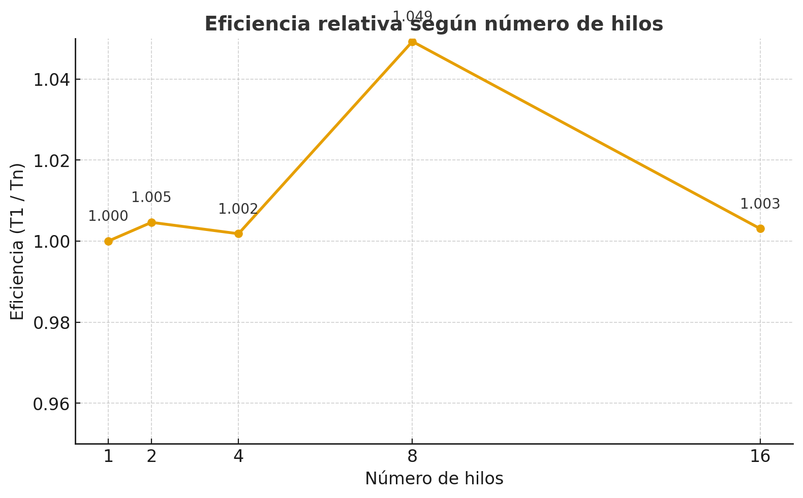

# 🧵 Laboratorio: Programación Paralela y Concurrente en C++

## 🧩 Fase 1: Fundamentos prácticos de concurrencia

### 🗂 Archivo: `threads_basic.cpp`

#### 1. ¿Qué patrón de ejecución se observa?

No hay un orden fijo entre los mensajes de los hilos; cada vez que se ejecuta el programa las líneas salen en distinto orden.  
Esto pasa porque el sistema operativo decide cuándo ejecutar cada hilo según el planificador y los recursos disponibles.

#### 2. ¿Se puede controlar el orden sin cambiar la lógica?

Sí, se puede usando algún tipo de sincronización (como `std::mutex`, `std::barrier` o variables de condición) o forzando pausas con `sleep_for`.  
Pero la idea de este ejemplo era justo ver cómo el sistema maneja la concurrencia por sí solo.

📸 **Evidencia:**  

---

## 🔒 Fase 2: Sincronización y exclusión mutua

### 🗂 Archivo: `contador_compartido.cpp`

#### 1. Comparación con y sin mutex

- **Sin mutex:** el contador final casi nunca llega al valor esperado (800000). Se pierden incrementos por condiciones de carrera.  
- **Con mutex:** el resultado es exacto, ya que el acceso a la variable está protegido.

#### 2. ¿Por qué ocurre el error sin sincronización?

Porque varios hilos escriben al mismo tiempo sobre la misma variable global.  
Cuando eso pasa, los valores se sobrescriben antes de ser actualizados correctamente.

#### 3. Estimación de “context switch”

En cada iteración pueden pasar muchos cambios de contexto dependiendo del sistema. Con 8 hilos activos y miles de iteraciones, probablemente ocurren miles o incluso decenas de miles de “context switches”.

📸 **Sin mutex:**  

📸 **Con mutex:**  

---

### 🗂 Archivo: `productor_consumidor.cpp`

#### 1. ¿Qué pasa si se elimina `cv_productor.wait`?

El productor intentaría meter datos al buffer incluso cuando está lleno, lo que podría causar bloqueos o pérdida de datos.  
El `wait` asegura que espere hasta que haya espacio disponible.

#### 2. ¿Por qué `unique_lock` en lugar de `lock_guard`?

Porque `unique_lock` deja bloquear y desbloquear manualmente el mutex, lo cual es necesario para usarlo junto con `wait` y `notify`.  
`lock_guard` solo bloquea hasta el final del bloque y no se puede controlar manualmente.

#### 3. ¿Qué garantiza `cv_consumidor.notify_all()`?

Despierta a todos los consumidores que están esperando, asegurando que alguno siga procesando cuando haya elementos nuevos.

📸 **Evidencia:**  

---

## ⚡ Fase 3: Mecanismos avanzados y análisis de rendimiento

### 🗂 Archivo: `semaforos_barrera.cpp`

#### Descripción

En este experimento se usa un **semaforo** para limitar cuántos hilos pueden usar un recurso a la vez (por ejemplo, un pool de 3 conexiones).  
También se agrega una **barrera** para que todos los hilos terminen una ronda antes de pasar a la siguiente.  
Se nota que el acceso está bien controlado y todos los hilos se sincronizan al final de cada ronda.

📸 **Evidencia:**  

---

### 🗂 Archivo: `test_run.sh`

#### 1. Resultados del experimento

| # de Hilos | Tiempo total (s) |
|-------------|------------------|
| 1           | 2.494399242      |
| 2           | 2.482862118      |
| 4           | 2.489823125      |
| 8           | 2.377227210      |
| 16          | 2.486731312      |

#### 2. Gráfico: Tiempo total vs número de hilos

📊 _Gráfico adjunto_  

#### 3. Explicación del resultado

El rendimiento no mejora de forma lineal porque:

- Crear y manejar hilos tiene su propio costo.  
- El procesador tiene un número limitado de núcleos.  
- Hay contención por recursos compartidos (mutex, buffers, etc.).  
- Los “context switches” y las esperas también agregan latencia.

---

## 🧠 Fase 4: Análisis y reflexión

### 1. Diferencia entre concurrencia y paralelismo

- **Concurrencia:** varios hilos avanzan “a la vez” compartiendo el procesador.  
- **Paralelismo:** varios hilos se ejecutan literalmente al mismo tiempo en distintos núcleos.  
En este laboratorio se vio principalmente concurrencia, aunque si el procesador tiene varios núcleos, algo de paralelismo real también ocurre.

### 2. Ventajas y desventajas de aumentar hilos

✅ **Ventajas:** mejor aprovechamiento del CPU y respuesta más fluida hasta cierto punto.  
❌ **Desventajas:** más sobrecarga, más sincronización y más pérdida de eficiencia por cambios de contexto.

### 3. Mecanismos para evitar condiciones de carrera

Se usaron **mutex**, **variables de condición** y **semaforos** para controlar el acceso a los recursos compartidos.
