# Clase 1

## Sistemas control de versiones

Beneficios principales:

- Historial de cambios
- Recuperar versiones anteriores (Rollbacks)
- Trabajo en equipo sin conflictos
- Seguimiento del progreso
- Pruebas seguras

### Centralizado

Existe un servidor central que contiene el historial completo, los usuarios descargan/copian archivos, se requiere tener conexión constantemente, como ejemplo subversion

### Distribuido

Cada desarrollador tiene una copia completa del reporsitorio, se puede trabajar localmente, por ejemplo git

### ¿Que es git?

Es un sistema de control de versiones que permite gestionar proyectos grandes, con eficiencia, seguridad y velocidad, es muy popular por su rapidez y eficiencia, permite que cada persona tenga una copia completa de todo el historial, se puede utilizar en distintos flujos de trabajo

### ¿Que es Github?

Permite alojar repositorios git, permite despliegue automatico e integracion continua, es una herramienta web para trabajar git

## Documentación en proyectos de software

No es solo comentar el codigo, ademas el codigo se debe comentar de buena manera, no magic numbers (Numeros sin explicacion), comentarios que tengan sentido y no sean redundantes

### Tipos de documentacion

**Documentacion para desarrolladores:**

- Comentarios en el codigo
- Manual de arquitectura
- Guía de estilos de codificación
- API docs

**Documentacion para usuarios finales:**

- Manuales de usuario
- Guia de instalación
- Tutoriales

**Documentacion para operadores o soporte:**

- Manual de despliegue
- Procedimientos de respaldo y recuperacion
- Documentacion de monitoreo

### Doxygen

Permite crear documentacion automatica para varios lenguajes de programacion dando como salida archivo html o pdf, entre otros

# Clase 2 (Actividad: Control de Versiones y Documentación de Software  )

## Parte 1: Control de versiones con Git

En esta sección se completaron los ejercicios interactivos del curso [Learn Git Branching](https://learngitbranching.js.org/).  

**Capturas de pantalla de los ejercicios completados:**  
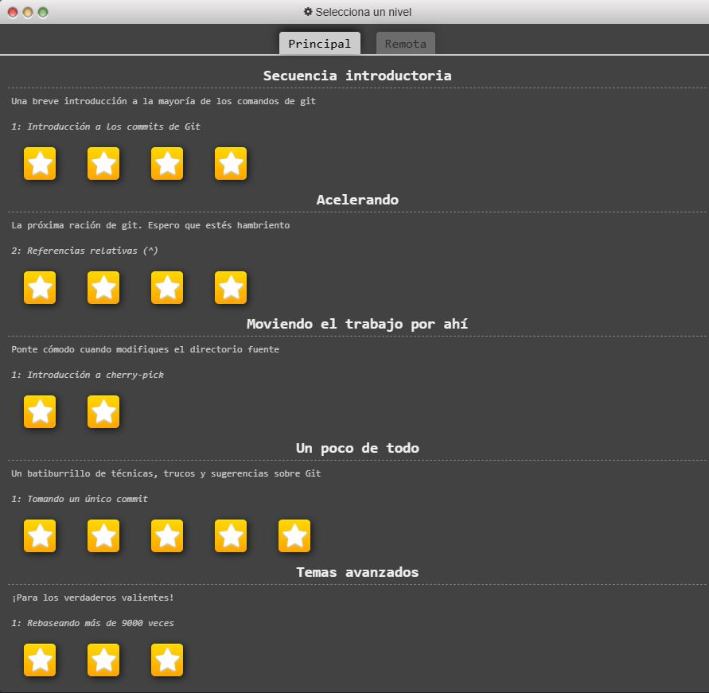  
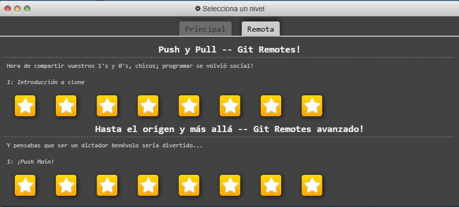  

---

## Parte 2: Documentación con Doxygen

Se seleccionó un repositorio en C/C++ que utiliza Doxygen para la documentación.  

**Repositorio utilizado:**  
[doxygen-example](https://github.com/nullromo/doxygen-example)  

**Capturas de pantalla de la documentación generada localmente:**  
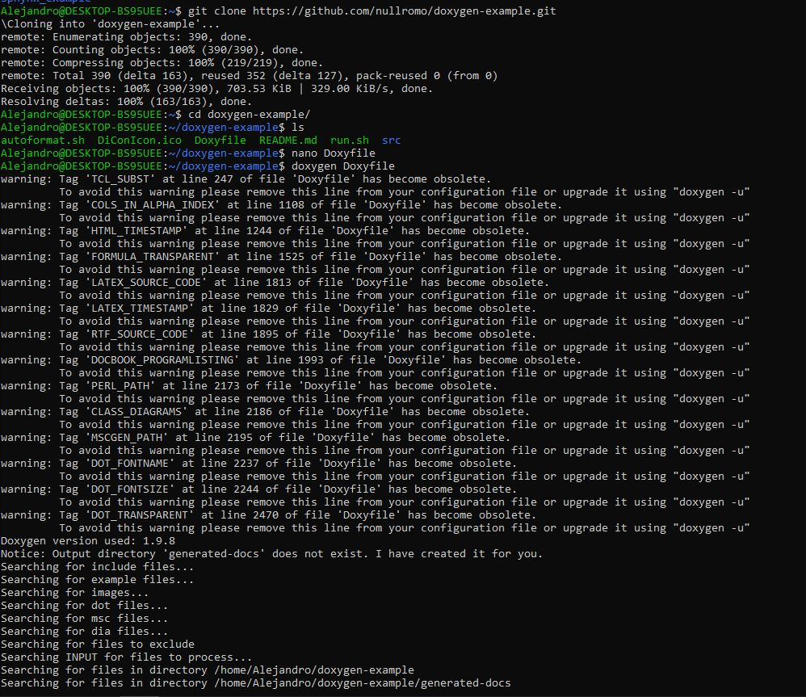  
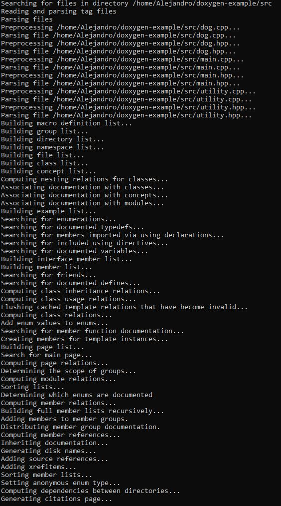  
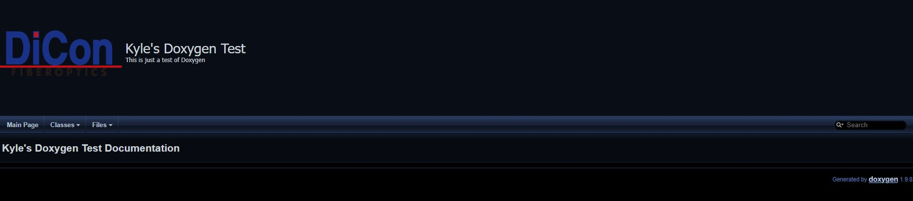  

---

## Parte 3: Documentación con Sphinx

Se seleccionó un repositorio en Python que utiliza Sphinx para la documentación.  

**Repositorio utilizado:**  
[Nombre del repositorio](https://github.com/jinhoyoo/sphynx_example)  

**Capturas de pantalla de la documentación generada localmente:**  
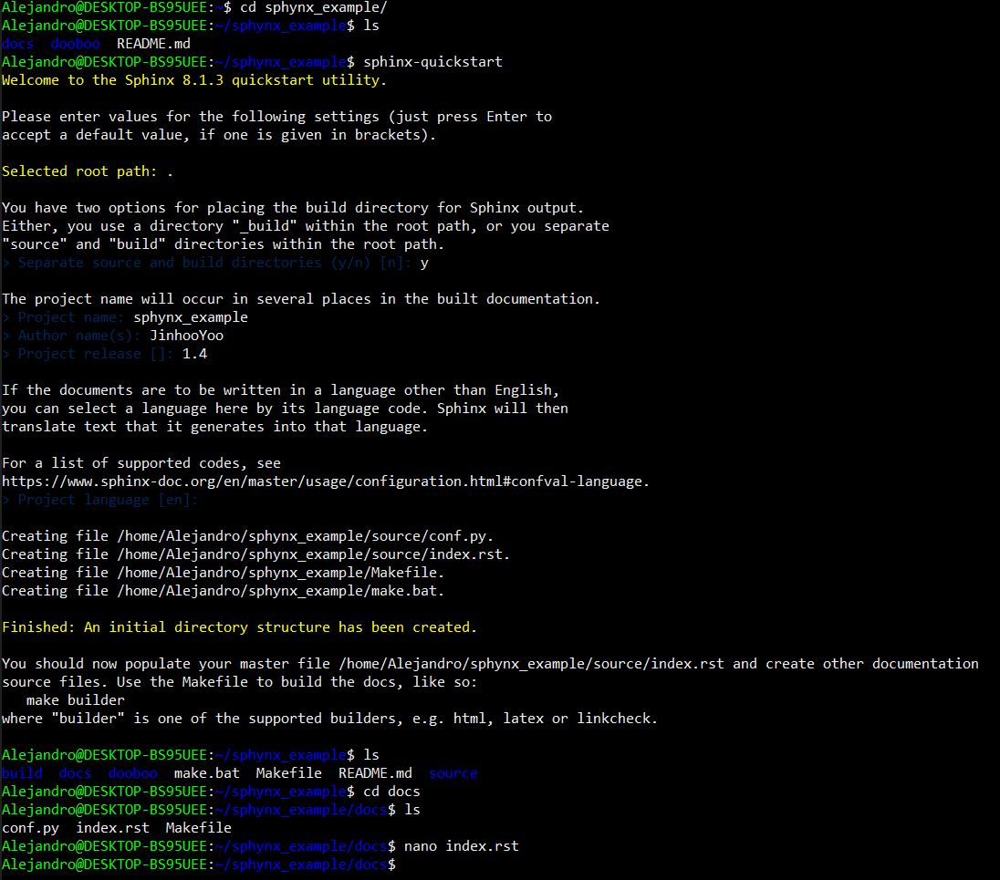  
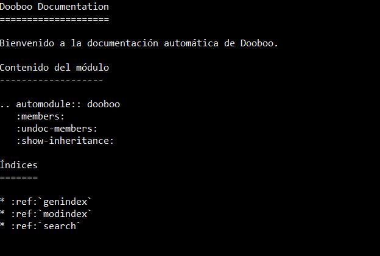  
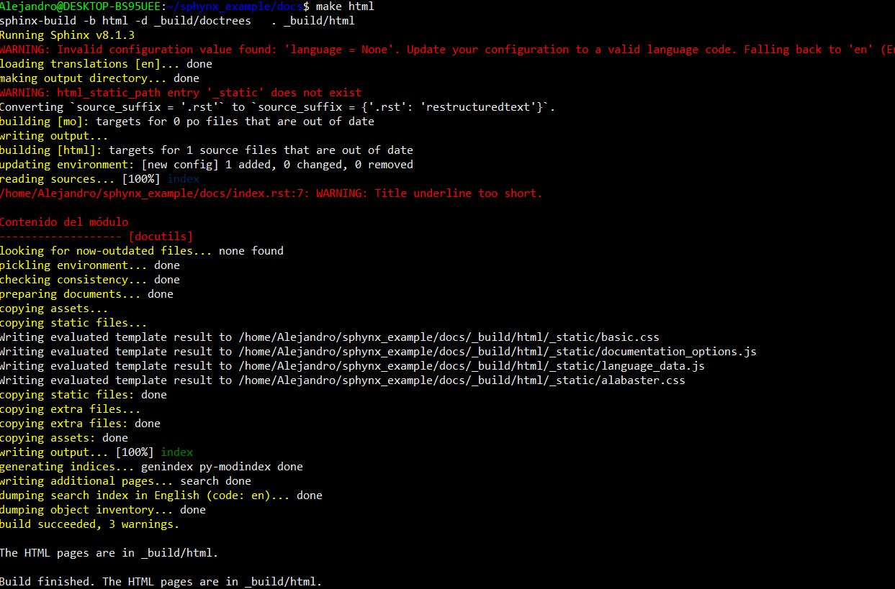  
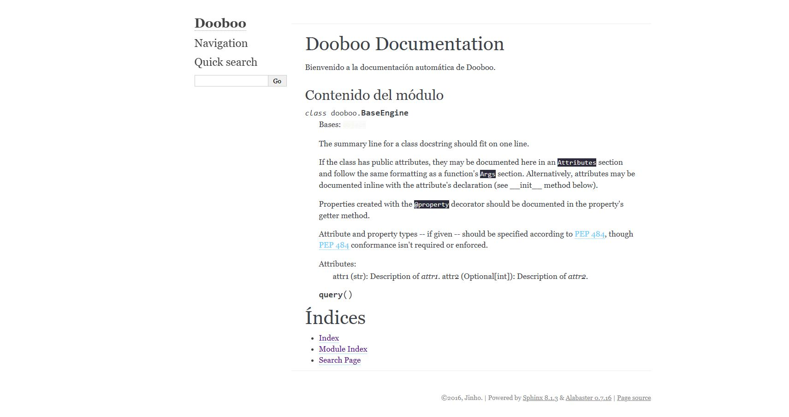  

---

## Parte 4: Publicación de documentación

Se publicaron ambas documentaciones en un servicio gratuito de hosting de páginas estáticas.  

**Documentación Doxygen (publicada):**  

- URL: [Enlace al sitio](https://doxygenexample.netlify.app)

- Capturas de pantalla:  

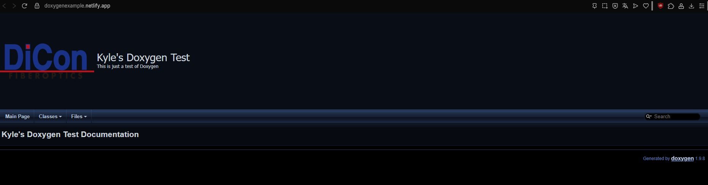  

**Documentación Sphinx (publicada):**  

- URL: [Enlace al sitio](https://sphinxeexample.netlify.app)  

- Capturas de pantalla:  
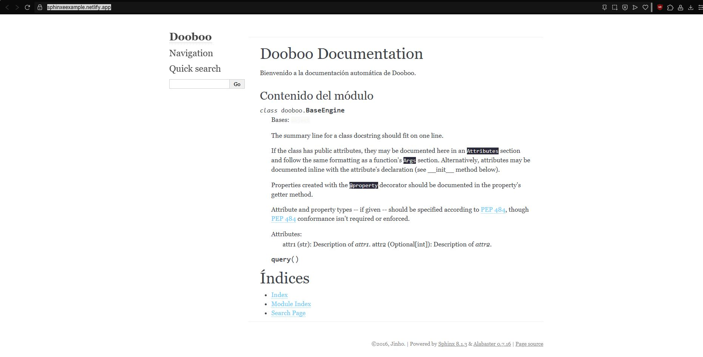  

---

Metadatos: Datos necesarios para que el sistema pueda leer correctamente un archivo

nic: Administra dominios de costa rica con extensión .cr

ICANN:Administra dominios de estados unidos

CLI: Command line interface

Workspace: Area o espacio de trabajo
