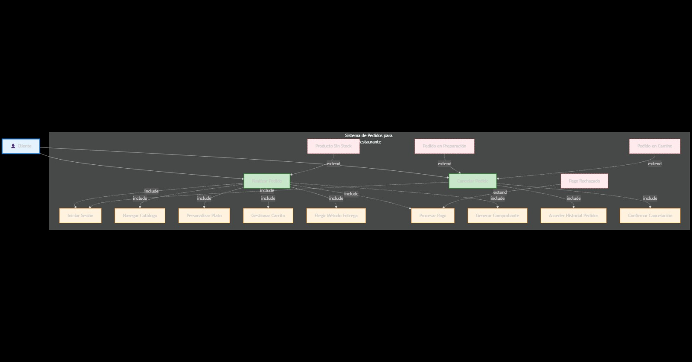

# Actividad práctica en grupos 
**Escenario elegido: Plataformas de pedidos para un restaurante**

## Lista de requerimientos

### Requerimientos funcionales

- **Registro/Inicio de sesión:** El sistema debe permitir registrarse e iniciar sesión con correo electrónico, número de teléfono y contraseña.  
- **Catálogo de productos:** El sistema debe mostrar menú por categorías (entradas, platos fuertes, bebidas, postres) con nombre, descripción, precio, disponibilidad, etc.  
- **Personalización del plato:** El usuario debe poder seleccionar variantes y agregar/remover ingredientes y extras con precio actualizado en tiempo real.  
- **Carrito de compras:** El sistema debe permitir añadir, editar cantidades y eliminar ítems; calcular subtotal, impuestos, cargos de envío, cargos de servicio y total.  
- **Direcciones y métodos de entrega:** El usuario debe elegir “Entrega a domicilio” (con dirección guardada) o “Retiro en tienda” (con sucursal).  
- **Métodos de pago:** El sistema debe aceptar al menos tarjeta, PayPal y efectivo contra entrega (configurable por el restaurante).  
- **Gestión operativa (cocina):** Panel para personal que liste pedidos por estado, permita cambiarlos y marque ítems sin stock en tiempo real.  
- **Confirmación y ticket:** Tras pagar/confirmar, el sistema debe generar número de pedido, resumen detallado y enviar comprobante por email y/o WhatsApp.  

### Requerimientos no funcionales

- **Rendimiento:** Tiempo de respuesta de páginas clave (menú, carrito, checkout) ≤ **2 s** para el **95%** de las solicitudes.  
- **Disponibilidad:** Disponibilidad anual ≥ **99.9%** excluyendo mantenimientos programados.  
- **Seguridad:** Todo el tráfico debe usar HTTPS; datos sensibles no se almacenan en servidores propios; contraseñas con hash seguro.  
- **Compatibilidad:** Aplicación compatible para móvil, tablet y escritorio.  
- **Privacidad:** Cumplimiento de política de datos del restaurante y el cliente.  

### Requerimientos técnicos

- **Arquitectura:** Aplicación web con API REST backend y frontend SPA/SSR.  
- **Autenticación:** Soporte OAuth 2.0/OpenID Connect opcional (Google/Apple) además de correo electrónico y contraseña.  
- **Panel de cocina/administración:** Acceso con roles (admin, cocina, atención) y control de permisos sobre operaciones (cambiar estado, editar menú, ver reportes).  

## Casos de uso

### Caso de uso 1: Realizar pedido

**Actor principal:** Cliente  

#### Precondiciones

- El cliente debe estar registrado e iniciar sesión.  
- Deben existir productos disponibles en el catálogo.  

#### Postcondiciones

- Se genera un comprobante que se envía al cliente por email y/o WhatsApp.  
- El pedido queda visible en el panel de cocina para su gestión.  

#### Flujo principal

1. El cliente inicia sesión en la plataforma.  
2. El cliente navega por el catálogo de productos organizado por categorías.  
3. El cliente selecciona un producto y lo personaliza (ingredientes, extras, variantes).  
4. El cliente añade el producto al carrito.  
5. El cliente revisa el carrito, edita cantidades.  
6. El sistema calcula el subtotal, impuestos, cargos de envío y total.  
7. El cliente elige el método de entrega: **Entrega a domicilio** o **Retiro en tienda**.  
8. El cliente selecciona un método de pago (tarjeta, PayPal o efectivo contra entrega).  
9. El cliente confirma el pedido.  
10. El sistema valida disponibilidad de productos y procesa el pago.  
11. El sistema genera el pedido, lo registra con número único y lo envía al panel de cocina.  
12. El sistema muestra un resumen del pedido y envía el comprobante al cliente.  

#### Flujos alternativos

- **A1: Producto sin stock**  
  - El sistema detecta que un producto está agotado.  
  - Informa al cliente y le permite reemplazarlo o eliminarlo.  
  - El flujo regresa al paso 5.  

- **A2: Pago rechazado**  
  - Si el pago falla, el sistema informa al cliente.  
  - El cliente puede intentar nuevamente con otro método de pago.  

### Caso de uso 2: Cancelar pedido

**Actor principal:** Cliente  

#### Precondiciones

- El cliente debe tener un pedido en curso (no entregado).  
- El cliente debe estar autenticado en la plataforma.  

#### Postcondiciones

- El pedido cambia de estado a “Cancelado”.  
- El comercio recibe la notificación en el panel de gestión operativa.  
- Si el pago ya se procesó, se inicia el reembolso según el método utilizado.  

#### Flujo principal

1. El cliente accede a su historial de pedidos.  
2. Selecciona un pedido en curso.  
3. Elige la opción **Cancelar pedido**.  
4. El sistema solicita confirmación.  
5. El cliente confirma la cancelación.  
6. El sistema cambia el estado del pedido a “Cancelado”.  
7. El sistema notifica al comercio y al cliente sobre la cancelación.  

#### Flujos alternativos

- **A1: Pedido en preparación**  
  - Si el pedido ya está en estado *En preparación*, el sistema bloquea la cancelación.  
  - Se informa al cliente que debe contactar directamente al restaurante.  

- **A2: Pedido en camino**  
  - Si el pedido ya fue despachado, la cancelación no está disponible.  
  - El sistema ofrece la opción de contactar soporte.  

# Diagrama UML

A continuación, un ejemplo de diagrama UML en formato imagen:

